# Deepfake Detection: Dual-Stream CNN (RGB + FFT)

Detects face-swap and face-reenactment deepfakes by looking at a face twice: once as pixels and once as a frequency spectrum. GAN upsampling leaves periodic artifacts that are hard to see in RGB but stand out in the FFT. A second stream that reads the spectrum catches what the pixel stream misses.



## Results

Held-out test split of **FaceForensics++ (C23)**: 4,937 face crops, decision threshold 0.5 ([`results/metrics.json`](results/metrics.json)).

| Metric | Score |
| --- | --- |
| Accuracy | **95.87%** |
| AUC-ROC | **0.9951** |
| F1 | 0.969 |
| Precision | 0.990 |
| Recall | 0.949 |
| False-positive rate | 1.97% |

Confusion matrix: 3,188 TP · 1,545 TN · 31 FP · 173 FN.

## How it works

1. **Face extraction**: MTCNN (with an OpenCV Haar fallback) pulls 224×224 face crops from 7,000+ videos, which gives **32,898 crops** across all five manipulation methods (Deepfakes, Face2Face, FaceShifter, FaceSwap, NeuralTextures).
2. **RGB stream**: an ImageNet-pretrained ResNet-18 reads spatial texture and blending seams.
3. **FFT stream**: a CNN reads the log-magnitude spectrum of the same crop, where upsampling artifacts show up as periodic peaks.
4. **Fusion**: the two embeddings are concatenated and classified as real or fake. Training uses a class-weighted loss because the data is about 2:1 fake/real.

Stack: PyTorch, torchvision, facenet-pytorch (MTCNN), OpenCV, Albumentations. A Flask app (`run.py`) serves image and video inference with Grad-CAM heatmaps.

## Quickstart

```bash
pip install -r requirements.txt
python scripts/precompute_faces.py --raw-dir data/raw/FaceForensics++_C23 --out-dir data/processed
python scripts/make_splits.py --processed-dir data/processed --output-dir data/splits
python run.py   # web UI for image / video inference
```

More detail: [`docs/technical_report.md`](docs/technical_report.md) · [`docs/architecture.md`](docs/architecture.md)

---


## Project Structure

```
DeepfakeDetection/
├── data/
│   ├── raw/                  # Raw videos (not tracked by git)
│   │   └── FaceForensics++_C23/
│   │       ├── original/     # Real videos
│   │       ├── Deepfakes/
│   │       ├── Face2Face/
│   │       ├── FaceShifter/
│   │       ├── FaceSwap/
│   │       └── NeuralTextures/
│   ├── processed/            # Face crops (not tracked by git)
│   └── splits/               # Train/val/test CSVs (not tracked by git)
├── scripts/
│   ├── precompute_faces.py   # Step 1 – extract face crops from videos
│   └── make_splits.py        # Step 2 – generate stratified CSV splits
├── src/
│   ├── data/
│   │   ├── face_detector.py  # MTCNN / Haar cascade wrapper
│   │   ├── dataset.py        # PyTorch Dataset
│   │   └── augmentation.py
│   ├── models/
│   ├── training/
│   └── utils/
├── configs/
├── requirements.txt
└── README.md
```

## Setup

```bash
pip install -r requirements.txt
```

## Data Pipeline

The pipeline runs in two steps. All output goes under `data/` which is git-ignored.

### Step 1 — Precompute face crops

Extracts 224×224 face crops from raw videos using MTCNN (falls back to OpenCV Haar cascade).

```bash
python scripts/precompute_faces.py \
    --raw-dir data/raw/FaceForensics++_C23 \
    --out-dir data/processed \
    --frame-stride 30 \
    --max-frames-per-video 10 \
    --workers 7 \
    --device cpu
```

| Argument | Default | Description |
|---|---|---|
| `--raw-dir` | `data/raw/FaceForensics++_C23` | Root of raw video dataset |
| `--out-dir` | `data/processed` | Output directory for crops |
| `--frame-stride` | `30` | Sample every Nth frame |
| `--max-frames-per-video` | `10` | Max frames sampled per video |
| `--workers` | `cpu_count - 1` | Parallel worker processes |
| `--device` | `cpu` | `cpu` or `cuda` for MTCNN |
| `--skip-existing` | `True` | Resume — skip already-processed videos |

Outputs:
- `data/processed/FaceForensics++_C23/{real,fake}/<video_id>/frame_*.jpg`
- `data/processed/precompute_manifest.csv`
- `data/processed/precompute_report.json`

#### Dataset stats (FaceForensics++ C23, 7,000 videos)

| | Count |
|---|---|
| Total face crops | 32,898 |
| Real (label 0) | 10,499 |
| Fake (label 1) | 22,399 |

> **Note:** The dataset is ~2:1 fake/real. Use a weighted loss or weighted sampler during training.

### Step 2 — Generate train/val/test splits

Stratified split by label (70 / 15 / 15).

```bash
python scripts/make_splits.py \
    --processed-dir data/processed \
    --output-dir data/splits \
    --train-ratio 0.70 \
    --val-ratio 0.15 \
    --test-ratio 0.15 \
    --seed 42
```

Outputs: `data/splits/train.csv`, `val.csv`, `test.csv` — each with columns `path`, `label`, `source_dataset`.

#### Split summary

| Split | Total | Real | Fake |
|---|---|---|---|
| Train | 23,028 | 7,349 | 15,679 |
| Val | 4,933 | 1,574 | 3,359 |
| Test | 4,937 | 1,576 | 3,361 |

## Face Detector

`src/data/face_detector.py` wraps two backends in priority order:

1. **MTCNN** (`facenet-pytorch`) — neural network detector, accurate
2. **OpenCV Haar cascade** — fallback if facenet-pytorch is not installed

Install MTCNN:
```bash
pip install facenet-pytorch
```
